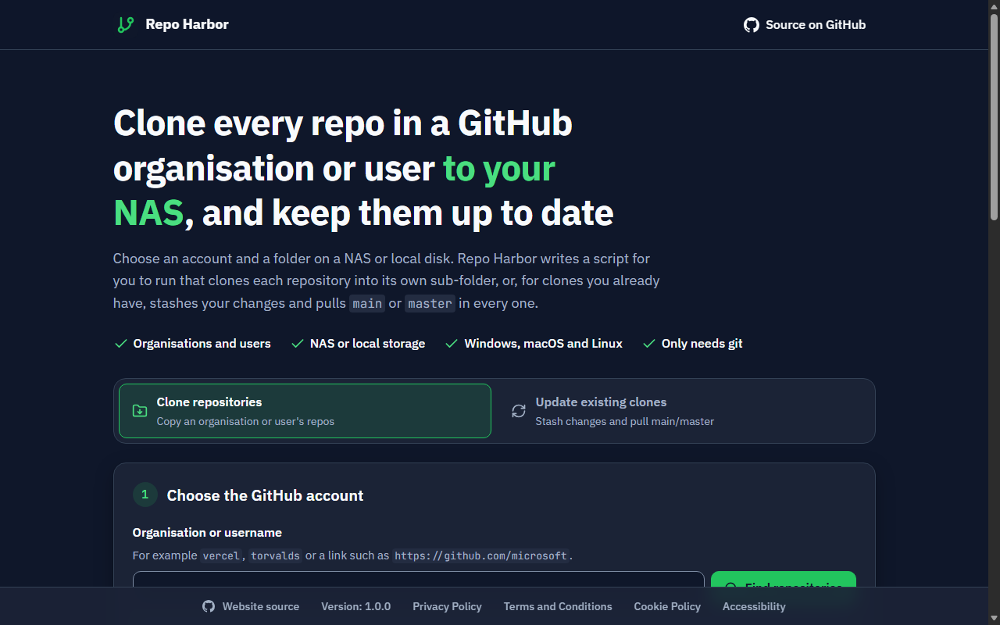
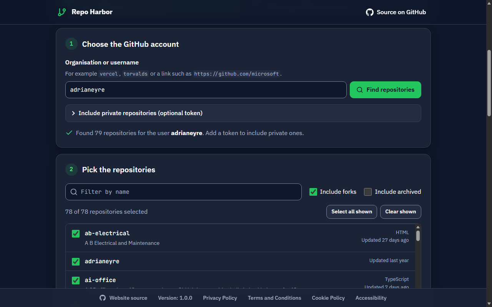
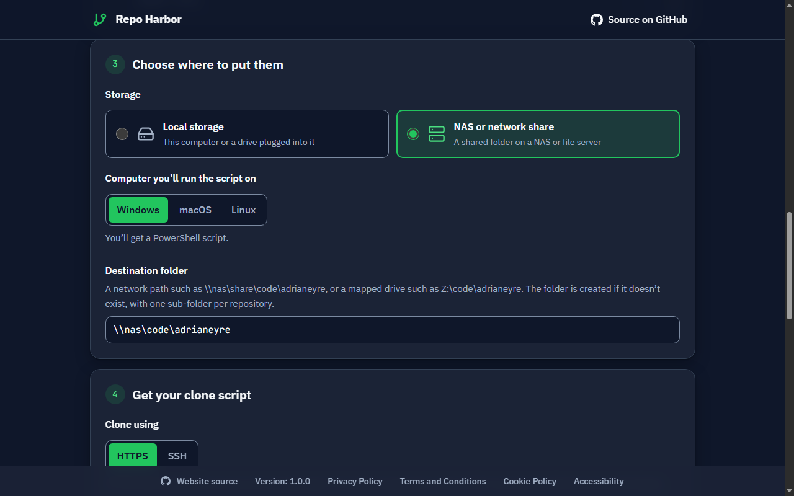
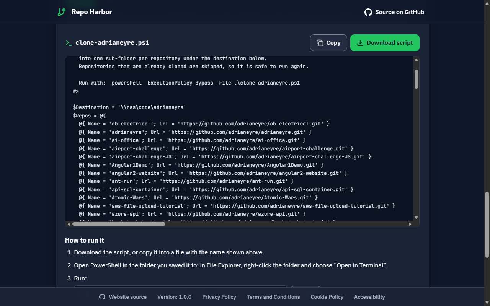
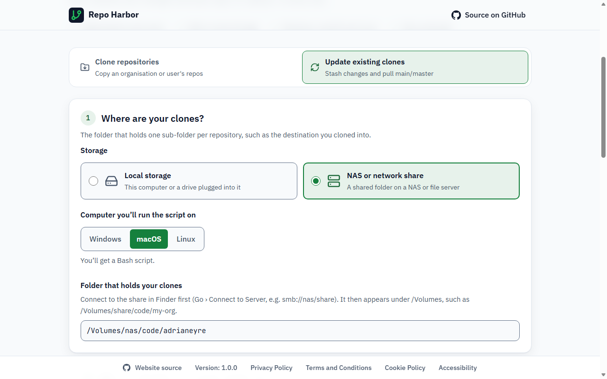
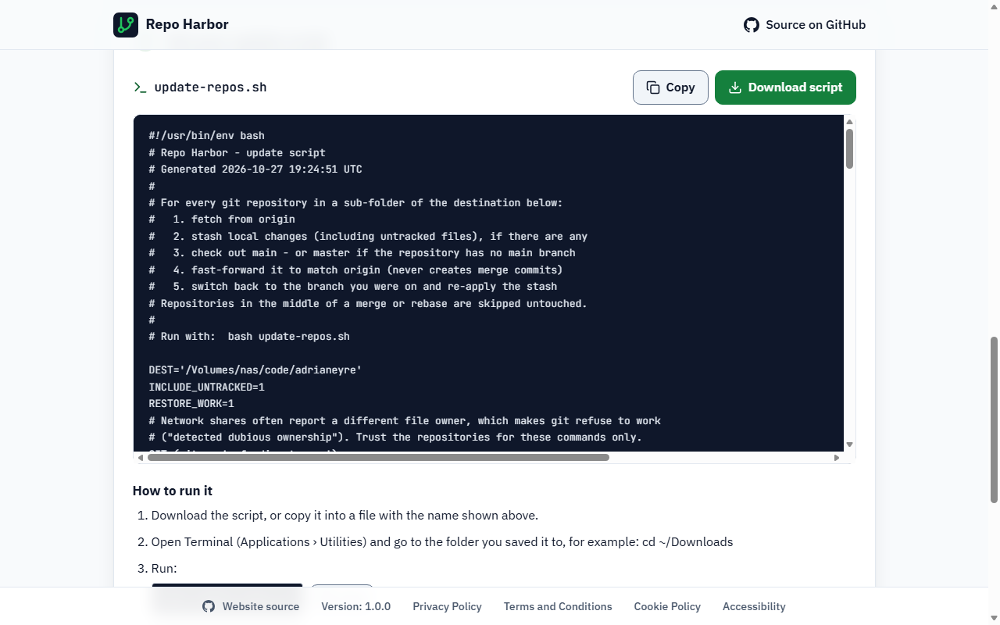
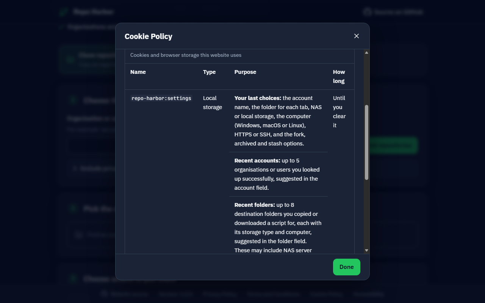
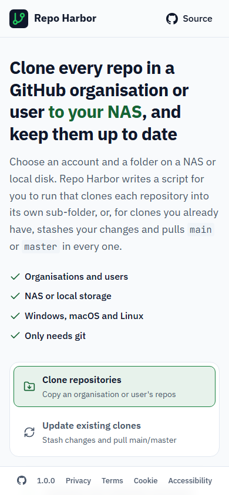
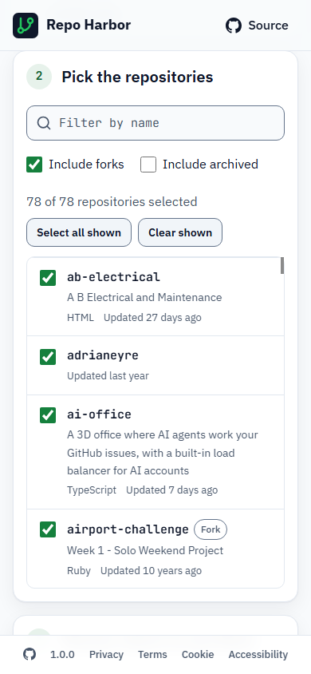
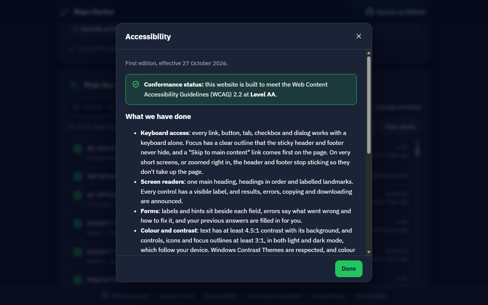

# Repo Harbor (github-harbor)

Clone every repository from a GitHub **organisation or user** into its own folder on a **NAS or local disk**, then keep them all up to date by stashing local changes and pulling `main`/`master` across every repo at once.

**Use it here: https://adrianeyre.github.io/github-harbor/**



- **Organisations and users:** public repos for anyone; add a token to include private ones.
- **NAS or local storage:** UNC paths (`\\nas\share`), mapped drives, `/Volumes/…` and `/mnt/…` all work.
- **Windows, macOS and Linux:** pick your computer and get a PowerShell script (Windows) or a Bash script (macOS and Linux), with paths, warnings and instructions for that system.
- **Nothing to install:** only needs `git`. If git is missing, the script tells you how to install it on your system.
- **Remembers you:** your last choices, recent accounts and recent folders are kept in your browser (never a token), so next time is a couple of clicks.

---

## Contents

- [Quick start](#quick-start)
- [Clone an organisation or user](#clone-an-organisation-or-user)
- [Update existing clones](#update-existing-clones)
- [Windows, macOS and Linux](#windows-macos-and-linux)
- [Using a NAS](#using-a-nas)
- [Private repositories](#private-repositories)
- [What the scripts do (and don't do)](#what-the-scripts-do-and-dont-do)
- [Troubleshooting](#troubleshooting)
- [Privacy](#privacy)
- [Accessibility](#accessibility)
- [Development](#development)
- [Releases and deployment](#releases-and-deployment)

## Quick start

1. Open **https://adrianeyre.github.io/github-harbor/**.
2. On **Clone repositories**, type an organisation or username (or paste a GitHub link) and press **Find repositories**.
3. Choose **Local storage** or **NAS or network share**, the computer you'll run it on (**Windows**, **macOS** or **Linux**), and a destination folder.
4. Press **Download script**, then run it:

   ```powershell
   # Windows
   powershell -ExecutionPolicy Bypass -File .\clone-<owner>.ps1
   ```

   ```bash
   # macOS or Linux, in Terminal
   bash clone-<owner>.sh
   ```

Later, use the **Update existing clones** tab to bring everything up to date.

> **Why a script?** Browsers aren't allowed to run git or write to your disks and network shares. So Repo Harbor does what a web page can: it finds the repositories with GitHub's API and writes a ready-to-run script. The script runs on your computer, and your code never passes through anyone else's.

## Clone an organisation or user

Repo Harbor works out whether the name belongs to an organisation or a user, and lists every repository, across as many pages as GitHub returns. You can filter by name, include or exclude **forks** and **archived** repositories, and tick exactly the ones you want.



Choose where they go and the computer you'll run the script on. The folder field suggests a path that suits your choices, offers folders you've used before, and warns you if a path doesn't fit (for example a `C:\` path for a Mac):



Choose **HTTPS** or **SSH**, and the script appears as you go, ready to copy or download:



Each repository is cloned into its own sub-folder:

```text
\\nas\code\acme\
├── api\
├── web\
└── docs\
```

Running the script again is safe. Repositories that are already cloned are skipped, so it only adds new ones.

## Update existing clones

Point the **Update existing clones** tab at the folder that holds your clones. For **every** git repository in its sub-folders, the script:

1. fetches from `origin`;
2. stashes any local changes, including untracked files unless you turn that off;
3. checks out `main`, or `master` if there's no `main`;
4. fast-forwards it to match `origin`. It never makes merge commits;
5. optionally switches back to the branch you were on and re-applies your stash.



The page then shows the script and how to run it on the computer you chose:



Stashes are labelled so you can find them:

```text
$ git stash list
stash@{0}: On feature/login: repo-harbor auto-stash 2026-10-27 09:15 (was on feature/login)
```

At the end you get a summary:

```text
[1/3] api
  Stashed local changes
  main is up to date

[2/3] legacy
  master is up to date

[3/3] web
  Local main has commits that are not on origin - left as is

Done. Updated: 2 of 3  Stashed: 1  Problems: 1
Local changes are stashed in (recover with "git stash pop"):
  - api
Needs attention:
  - web (main has diverged from origin)
```

Repositories in the middle of a merge, rebase, cherry-pick or revert are **skipped untouched**. The update script is a good fit for a scheduled task or cron job.

## Windows, macOS and Linux

| | Windows | macOS | Linux |
| --- | --- | --- | --- |
| **Script** | PowerShell (`.ps1`) | Bash (`.sh`) | Bash (`.sh`) |
| **Works with** | Windows PowerShell 5.1 (built in) and PowerShell 7 | the Bash 3.2 that comes with macOS, or newer | Bash 3.2 or newer |
| **Getting git** | [Git for Windows](https://git-scm.com/download/win) or `winget install --id Git.Git -e` | `xcode-select --install` or `brew install git` | `sudo apt install git`, `sudo dnf install git`, `sudo pacman -S git` |
| **Run it** | `powershell -ExecutionPolicy Bypass -File .\clone-<owner>.ps1` | `bash clone-<owner>.sh` in Terminal | `bash clone-<owner>.sh` |
| **Local folder** | `C:\Code\acme` | `~/Code/acme` | `~/code/acme` |
| **NAS folder** | `\\nas\share\code\acme` or `Z:\code\acme` | `/Volumes/share/code/acme` | `/mnt/nas/code/acme` |

The page picks your system automatically, and you can change it if you're making a script for another computer.

**Checking git:** every script starts by running `git --version`, not just looking for a `git` command. On a Mac without Apple's developer tools, `/usr/bin/git` exists but only opens an installer prompt. Rather than failing on every repository, the script stops straight away and says how to install git on the system it's running on:

```text
Git is not installed, or is not working. Install it by running: xcode-select --install (or: brew install git), then try again.
```

Every change is tested on all three systems. CI runs the generated scripts for real on Windows (Git Bash, PowerShell 7 and Windows PowerShell 5.1), macOS (its own `/bin/bash` 3.2 and PowerShell 7) and Linux (bash and PowerShell 7).

## Using a NAS

| You run it on | Example destination |
| --- | --- |
| Windows | `\\nas\share\code\acme` (UNC path) or `Z:\code\acme` (mapped drive) |
| macOS | `/Volumes/share/code/acme` (connect in Finder first) |
| Linux | `/mnt/nas/code/acme` (wherever the share is mounted) |

When **NAS or network share** is selected, the scripts:

- **Trust the share:** run git with `-c safe.directory=*`. Network shares often report a different owner for files, and without this git refuses to work with them ("detected dubious ownership"). This only applies to the script's own git commands and doesn't change your git config.
- **Make clones that work from any OS:** clone with `core.autocrlf=false` and `core.fileMode=false`, saved in each repository. Files stay exactly as committed, and the executable bit, which shares rarely store faithfully, is ignored. Without this, a repo cloned from Windows would look modified from a Mac or Linux PC (and the reverse), and the update script would stash it every time.

The page warns you if a path doesn't suit your choices, for example a Windows path for a Mac, `C:` as a NAS location, or a Mac NAS path outside `/Volumes`.

## Private repositories

- **Listing them:** open **Include private repositories** and add a [fine-grained personal access token](https://github.com/settings/personal-access-tokens/new) with read-only **Metadata** access to the organisation or account. A token also raises GitHub's API limit from 60 to 5,000 requests an hour. It's held only in the page's memory and sent only to `api.github.com`. It's never saved, and never written into a script.
- **Cloning them:** git on your computer needs to be signed in to GitHub. Git for Windows (Git Credential Manager) and GitHub Desktop handle this for HTTPS. Elsewhere, run `gh auth login`, or choose **SSH** if you have an SSH key on GitHub.

## What the scripts do (and don't do)

| They do | They never |
| --- | --- |
| create the destination folder | delete files or folders |
| `git clone` into empty or new sub-folders | overwrite a non-empty folder |
| `git fetch --prune`, `git stash push`, `git checkout`, `git merge --ff-only` | force-push, reset or rebase |
| print progress and a summary, and exit with code 1 if anything needs attention | send anything anywhere except to the git remotes |

PowerShell scripts download with a UTF-8 byte-order mark, so Windows PowerShell 5.1 reads folder names with accents correctly.

## Troubleshooting

| Problem | Fix |
| --- | --- |
| `running scripts is disabled on this system` | Run with `powershell -ExecutionPolicy Bypass -File .\script.ps1`, as the page shows. |
| `Git is not installed, or is not working` | Follow the instructions it prints for your system (see [Windows, macOS and Linux](#windows-macos-and-linux)), then open a new terminal. |
| `xcrun: error: invalid active developer path` on a Mac | Run `xcode-select --install` (often needed again after a macOS upgrade). |
| A Windows path in a Mac or Linux script, or the reverse | Choose the computer you'll actually run the script on. The page warns you about mismatched paths. |
| `detected dubious ownership` | Choose **NAS or network share** so the script trusts the share. |
| `Authentication failed` / `Repository not found` on clone | Sign git in to GitHub (see [Private repositories](#private-repositories)) or switch to SSH. |
| `Please tell me who you are` when stashing | Set your identity: `git config --global user.name "Your Name"` and `user.email`. |
| GitHub's API rate limit reached | Wait for the time shown, or add a token. |
| `Local main has commits that are not on origin` | That repo's `main` has diverged. Push or reset it yourself, as the script won't. |

## Privacy

No analytics, no tracking, no cookies, and no server of its own. The only network requests are to GitHub's API, made straight from your browser.

Your browser's local storage (key `repo-harbor:settings`) keeps:

- **your last choices:** account, folders, storage type, computer and options, filled in next time;
- **recent accounts:** up to 5 you looked up successfully, suggested in the account field;
- **recent folders:** up to 8 you copied or downloaded a script for, suggested in the folder field when the storage type and computer match.

It never keeps a token, the repository list or the scripts, and it never leaves your device. **Clear my saved settings** in the Cookie Policy removes it all.



The sticky footer links to the full Privacy Policy, Terms and Conditions, Cookie Policy and Accessibility statement, each in a dialog. The version number opens the Changelog.

## Accessibility

Built to meet **WCAG 2.2 Level AA**, in light and dark mode, and down to a 320px-wide phone:

<p>
  
  &nbsp;
  
</p>

- **Keyboard:** everything works without a mouse, including the tabs (arrow keys, Home, End). A skip link comes first, and focus is always visible and never hidden by the sticky header or footer. On very short screens or at high zoom they stop sticking.
- **Screen readers:** labelled landmarks, headings in order, a visible label on every field, and errors, results, copying and downloading announced through live regions.
- **Contrast:** at least 4.5:1 for text and 3:1 for controls and focus outlines, in both themes. `src/contrast.test.ts` checks every colour pairing on every test run, and an axe-core audit of the page reports no violations.
- **Reflow and targets:** no sideways scrolling at 320px or 400% zoom, with targets of at least 24×24px (44px for main controls).
- **Preferences:** follows the device's light or dark setting, reduced motion and Windows Contrast Themes.
- **Dialogs:** policies and the Changelog use native modal dialogs that trap focus, close on Escape and return focus to whatever opened them.



## Development

Needs Node 22 or later and git, on Windows, macOS or Linux. PowerShell 7 (`pwsh`) is optional, for the PowerShell integration tests outside Windows.

```bash
npm ci
npm run dev        # http://localhost:5173
npm test           # unit tests, WCAG contrast checks and end-to-end runs of the generated scripts
npm run build      # type-check and build to dist/
npm run preview    # serve dist/
```

The integration tests (`src/scripts/scripts.integration.test.ts`) **run the generated scripts for real** against local git repositories, in every shell installed: Bash, PowerShell 7 and, on Windows, Windows PowerShell 5.1. For each shell they:

- clone a `main` repo and a `master` repo to a NAS-style destination whose name has a space and an apostrophe in it, and check the cross-OS settings;
- re-run the clone to check repos are skipped;
- run the update script on a repo that's on a feature branch with edits and untracked files, in both stash modes;
- put a broken `git` first on `PATH`, like a Mac's placeholder, and check the script stops with install instructions for the current OS.

Set `REPO_HARBOR_BASH` or `REPO_HARBOR_PWSH` to test a particular shell, e.g. `REPO_HARBOR_BASH=/bin/bash` on a Mac.

| Path | What's there |
| --- | --- |
| `src/github.ts` | GitHub API client: tells organisations from users, paginates, and explains errors such as rate limits |
| `src/scripts/clone.ts`, `update.ts` | Script generators for PowerShell and Bash |
| `src/scripts/preflight.ts` | The git check with install instructions per OS, and the cross-OS NAS clone settings |
| `src/scripts/quote.ts` | Shell-safe quoting for paths and names |
| `src/main.ts`, `src/ui/` | The page: tabs, forms, repository picker, dialogs, saved settings and recents |
| `src/ui/platforms.ts` | Path examples, path warnings, run steps and git install hints for Windows, macOS and Linux |
| `src/changelog.ts` | Renders `CHANGELOG.md` in the footer's Changelog dialog |
| `src/styles.css` | Design tokens for the dark and light themes, and the styles |
| `index.html` | Markup, SEO, Open Graph and Twitter metadata, JSON-LD, and the policy text |
| `public/` | Favicons, web app manifest and the social preview image |
| `brand/` | Sources for the social image and icons (`bash brand/render.sh`) |
| `docs/images/` | Screenshots used in this README |

### SEO and social previews

The page has a description, canonical URL, `robots.txt`, `sitemap.xml`, JSON-LD (`WebApplication`), and Open Graph and Twitter card tags with a 1200×630 preview image, so links pasted into Slack, Teams, LinkedIn, X, Facebook, WhatsApp or Discord show the image and a description. The build fills in absolute URLs from `SITE_URL`, which the workflow takes from the Pages settings.

## Releases and deployment

`.github/workflows/ci.yml` runs on every pull request and every push to `main`:

1. **Gate**, on Windows, macOS and Linux: typecheck, tests (including the real script runs in every shell) and build.
2. **Release** (on `main`): [semantic-release](https://semantic-release.gitbook.io/) works out the next version from [Conventional Commits](https://www.conventionalcommits.org/) (`fix:` → patch, `feat:` → minor, `feat!:` or `BREAKING CHANGE:` → major). It updates `CHANGELOG.md` and `package.json` in a `chore(release)` commit, tags `v<version>` and creates a GitHub release.
3. **Pages:** builds the tip of `main`, including that release commit, and deploys it to GitHub Pages, so the footer's version and Changelog always match the latest release.

**One-time setup:** in **Settings → Pages**, set **Source** to **GitHub Actions**. If `main` is protected, let GitHub Actions push the release commit, or give semantic-release a token that can. If branch protection requires the gate check, require all three `Typecheck, test and build (…)` checks.

> The repository used to be called `github-clone`. GitHub redirects old links and clones, and older Changelog entries still link to commits under the old name.
